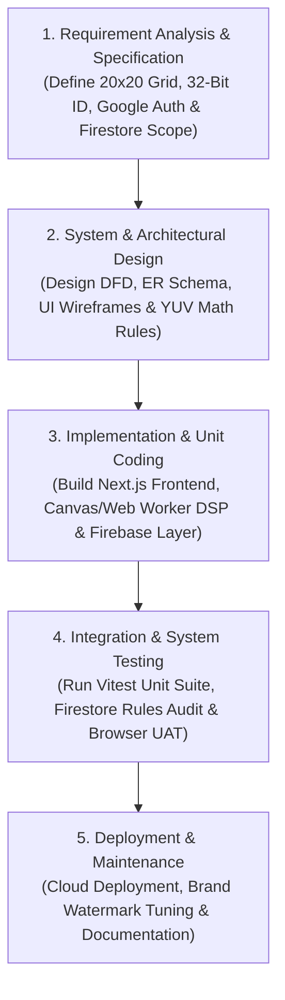
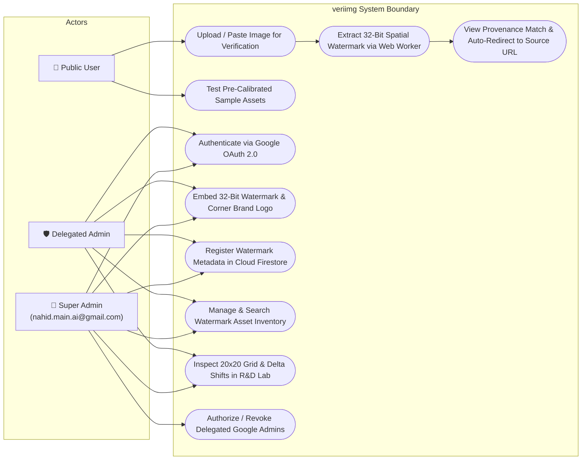
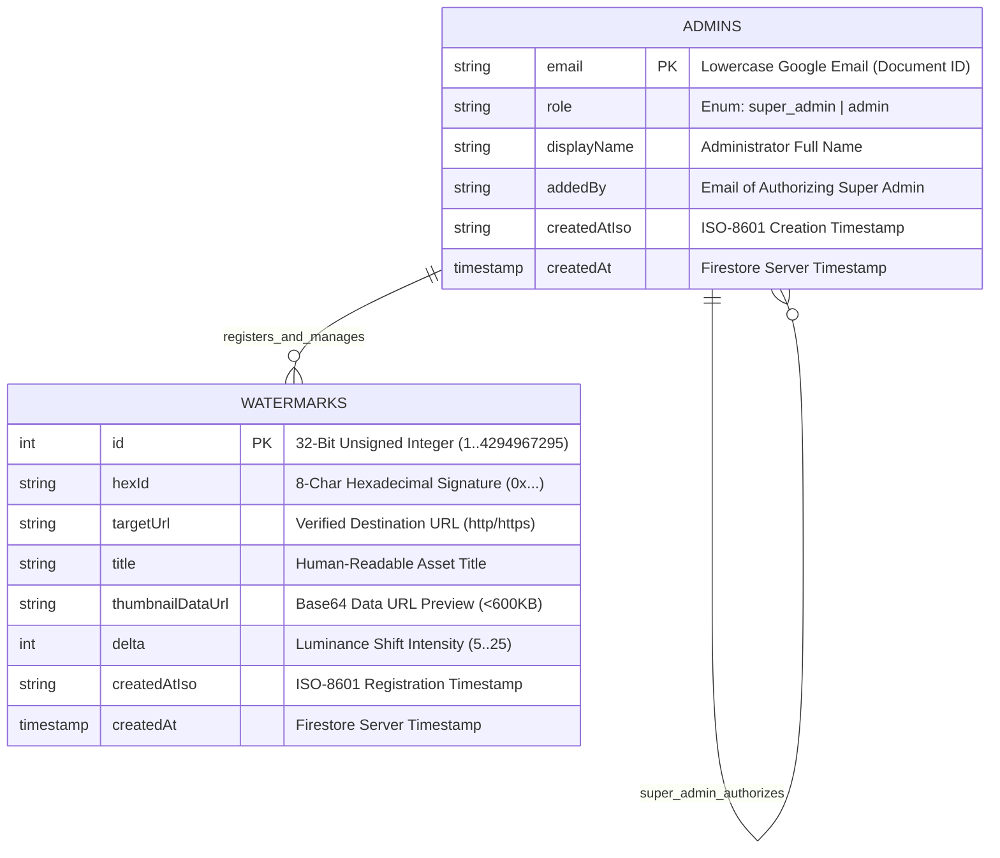
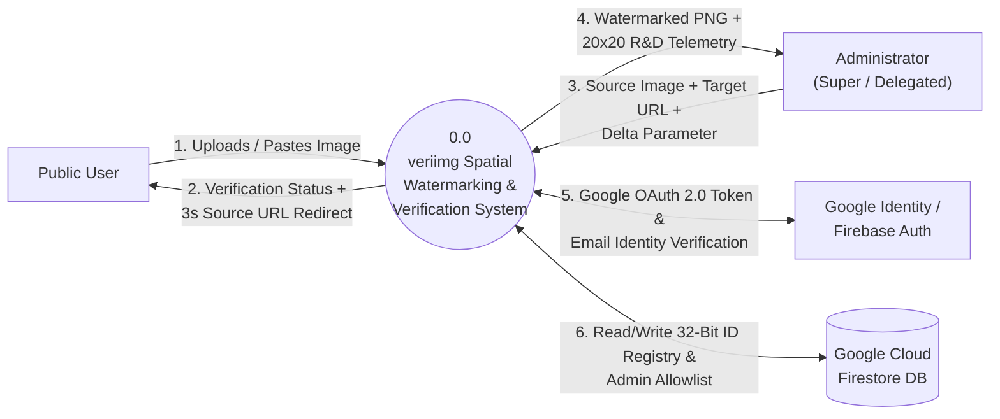
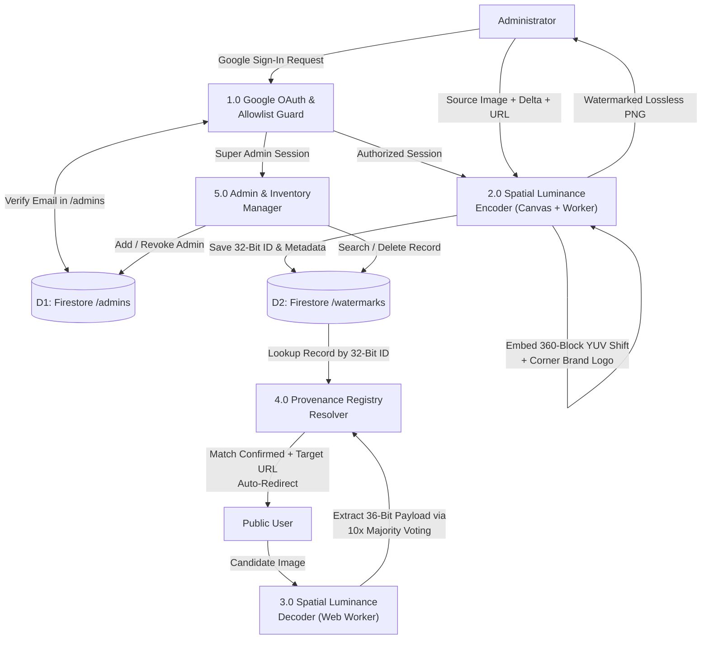

# VERIIMG: CLIENT-SIDE SPATIAL IMAGE WATERMARKING AND AUTHENTICITY VERIFICATION SYSTEM

### Imperceptible 32-Bit Spatial Luminance Encoding and Cryptographic Origin Verification Platform

**Submitted by:**

**MD NAHID HASAN SAGOR**

Registration No.: **21502005603**

Department of Computer Science & Engineering (CSE)

**Supervised by:**

**Shekh Tanjil Sharif**

Department of Computer Science & Engineering

**INSTITUTE OF SCIENCE TRADE AND TECHNOLOGY (ISTT)**

---

## DEPARTMENTAL APPROVAL

This is to certify that the project work entitled **"VERIIMG: CLIENT-SIDE SPATIAL IMAGE WATERMARKING AND AUTHENTICITY VERIFICATION SYSTEM"** has been carried out by **Md Nahid Hasan Sagor** (Reg: **21502005603**), a student of 3rd Year, 6th Semester in the Department of Computer Science and Engineering at the Institute of Science Trade and Technology (ISTT). This work has been approved as a part of the partial fulfillment of the requirements for the Bachelor of Science degree in Computer Science and Engineering.

**Supervisor:**

**Shekh Tanjil Sharif**

Department of Computer Science & Engineering (ISTT)

**Head of the Department:**

**Sk Mamunur Rashid**

Head, Department of Computer Science and Engineering (ISTT)

---

## ABSTRACT

In the contemporary digital media ecosystem, unauthorized redistribution of visual assets, stripping of standard EXIF metadata by social media platforms, and the proliferation of unverified synthetic imagery have created a critical provenance gap for publishers, photographers, and academic institutions. Traditional visible watermarks degrade visual aesthetics and are easily cropped out, while conventional metadata headers are routinely erased during file re-encoding and distribution. To address this challenge, **veriimg** introduces a zero-server-upload, client-side spatial image watermarking and cryptographic origin verification platform built using **Next.js (App Router), React 19, TypeScript, Tailwind CSS, HTML5 Canvas API, Web Workers, Firebase Authentication, and Google Cloud Firestore**.

The system implements a deterministic **20×20 spatial macro-block partitioning algorithm** combined with a **Differential Block Luminance Algorithm** in the ITU-R BT.601 YUV color space. A 32-bit unsigned integer identifier is converted into a 36-bit binary payload (comprising a 4-bit `1010` synchronization preamble and a 32-bit asset identifier) and redundantly encoded nearly tenfold across 360 interior image blocks—leaving a 1-block perimeter buffer to resist edge cropping. During verification, any user can drop an image into the public portal to extract the embedded 32-bit payload via statistical majority voting entirely within their browser's Web Worker thread, resolving the extracted identifier against an immutable Cloud Firestore registry to confirm provenance and redirect to the official source URL.

Furthermore, **veriimg** incorporates a zero-trust, enterprise-grade administrative console governed by Google OAuth 2.0 and role-based Firestore security rules. Only a designated Super Administrator and explicitly allowlisted Google accounts can access the management dashboard to embed new spatial signatures, inspect live 20×20 signal extraction matrices in an interactive Research & Development (R&D) Calibration Lab, manage the watermark inventory, and delegate administrative privileges. By executing all pixel-level digital signal processing on the client device, **veriimg** eliminates server compute bottlenecks, preserves end-to-end media privacy, and delivers sub-second verification accuracy.

**Keywords:** Spatial Domain Watermarking, Differential Block Luminance, ITU-R BT.601 YUV Color Space, HTML5 Canvas DSP, Web Workers, Next.js, Firebase Cloud Firestore, Media Provenance & Authentication

---

## TABLE OF CONTENTS

* **Chapter-1: Introduction**
  * 1.1 Background of the Study
  * 1.2 Aims and Objectives
  * 1.3 Scope of the Project
* **Chapter-2: System Analysis**
  * 2.1 Existing System and Proposed System
  * 2.2 Software Process Model (Waterfall Model)
  * 2.3 Non-Functional Requirements
  * 2.4 Functional Requirements
  * 2.5 Project Requirement Specification
  * 2.6 Cost Benefit Analysis
  * 2.7 Risk Analysis
* **Chapter-3: System Design**
  * 3.1 Use Case Diagram
  * 3.2 Entity Relationship (ER) Diagram
  * 3.3 Data Flow Diagram (Level-0)
  * 3.4 Data Flow Diagram (Level-1)
* **Chapter-4: Implementation**
  * 4.1 Coding
  * 4.2 Testing
  * 4.3 Debugging
* **Chapter-5: System Outputs & Screenshots**
  * 5.1 Landing / Authentication Pages
  * 5.2 Main Dashboard
  * 5.3 Core Operational Views
* **Chapter-6: Conclusion and Future Scope**
  * 6.1 Limitations
  * 6.2 Future Work
  * 6.3 Conclusion
* **References**

---

## CHAPTER 1: INTRODUCTION

### 1.1 Background of the Study

Digital images serve as foundational evidence in journalism, academic publishing, e-commerce, digital art, and institutional communications. However, once a digital image is published on the internet, its origin and authenticity become extraordinarily difficult to verify. Standard file metadata standards—such as EXIF (Exchangeable Image File Format), IPTC, and XMP—store attribution data in file headers outside the actual pixel matrix. Whenever an image is uploaded to social media networks, messaging platforms, or content delivery networks (CDNs), these header segments are automatically stripped to reduce file size and protect user privacy, severing the link between the visual asset and its rightful creator.

Conversely, visible overlays and large opaque watermarks obstruct critical visual content and can be effortlessly removed using automated cropping or inpainting tools. While server-side steganography and deep-learning watermarking frameworks exist, they typically require users to upload sensitive, high-resolution original media to remote servers for processing—introducing severe privacy risks, high cloud GPU/CPU hosting costs, and network latency. Consequently, there is a pressing academic and industry need for a lightweight, mathematically deterministic, browser-native watermarking and provenance verification system that embeds an imperceptible cryptographic identifier directly within the pixel luminance domain while mapping that identifier to a tamper-proof cloud registry.

### 1.2 Aims and Objectives

* **To design and implement a deterministic spatial-domain watermarking algorithm:** Develop a 20×20 macro-block partitioning engine that embeds a 36-bit binary frame (4-bit `1010` preamble + 32-bit unsigned integer ID) using differential luminance modulation ($\pm\Delta Y$) in the ITU-R BT.601 color space alongside a subtle corner brand mark.
* **To achieve zero-server-upload client-side digital signal processing (DSP):** Utilize the HTML5 Canvas 2D API (`willReadFrequently: true`) and background Web Workers to perform real-time pixel array manipulation and majority-voting bit extraction without blocking the main UI thread or transmitting raw images over the network.
* **To establish a secure, role-based cloud provenance registry:** Integrate Firebase Authentication (Google OAuth 2.0) and Cloud Firestore with strict security rules, enabling a Super Administrator (`nahid.main.ai@gmail.com`) to govern an allowlist of delegated administrators and maintain a real-time inventory of watermarked assets.
* **To provide an interactive Research & Development (R&D) Calibration Lab and Public Verification Portal:** Deliver an intuitive, responsive user interface featuring live 20×20 bit-grid overlays, luminance shift telemetry, configurable $\Delta$ intensity sliders, and automatic countdown redirection to verified destination URLs.

### 1.3 Scope of the Project

The **veriimg** system encompasses two distinct operational environments within a unified web application:

1. **Public Verification Portal:** Accessible to any internet user without authentication. Users can upload an image from their local device, paste an image directly from their system clipboard, or select from pre-calibrated sample assets. The browser immediately decodes the spatial watermark, displays the extracted 32-bit integer and hexadecimal signature (`0x...`), queries the Cloud Firestore registry, and—upon verification—initiates a 3-second cancellable auto-redirect to the registered publisher URL.
2. **Enterprise Admin Console & R&D Lab:** Protected behind a Google-only OAuth authentication gate and a Super Admin allowlist. Authorized administrators can access five specialized modules:
   * **Overview Dashboard:** Displays key metrics including total registered watermarks, active Google administrators, encoding capacity ($2^{32} \approx 4.29 \times 10^9$ unique IDs), and recent asset registrations.
   * **Image Inventory:** Provides a searchable, sortable registry of all watermarked assets with instant re-verification and deletion capabilities.
   * **Watermark Creation Studio:** Allows administrators to upload high-resolution source imagery, calibrate luminance shift intensity ($\Delta \in [5, 25]$), embed a 32-bit cryptographic ID plus a subtle bottom-right brand logo watermark, download the lossless PNG output, and register the destination URL in Firestore.
   * **R&D Calibration Lab:** Renders an interactive 20×20 visual grid overlay on top of test images, inspecting block-by-block differential luminance extraction and preamble synchronization in real time.
   * **Admin Manager:** Restricts administrative governance exclusively to the Super Admin, who can authorize or revoke delegated Google administrator accounts.

*System Boundaries & Exclusions:* The current system focuses on spatial-domain luminance watermarking exported in lossless PNG format and resistant to arbitrary uniform rescaling and minor perimeter border interference. Severe geometric distortions (such as arbitrary rotation, non-uniform perspective warping, or aggressive sub-sampling JPEG compression at very low quality factors) are outside the current spatial-grid scope and are designated for future frequency-domain (DCT/DWT) extensions.

---

## CHAPTER 2: SYSTEM ANALYSIS

### 2.1 Existing System and Proposed System

* **Existing System:**
  * **Header-Based Metadata (EXIF/IPTC):** Stores ownership and origin links in file header tags. Virtually 100% of major social platforms strip EXIF data upon upload, rendering attribution useless in the wild.
  * **Visible Text/Logo Overlays:** Degrades aesthetic quality, obscures key areas of photographs or academic diagrams, and is easily removed via basic cropping or AI content-aware fill.
  * **Centralized Server-Side Watermarking APIs:** Requires uploading confidential, high-resolution source files to external servers, incurring bandwidth delays, server compute expenses, and data privacy concerns.
  * **Manual Reverse Image Search:** Relies on third-party search engine indexing, which fails for newly published assets, private documents, or visually similar derivatives.

* **Proposed System:**
  * **Pixel-Level Spatial Encoding:** Embeds a 32-bit identifier directly into the pixel luminance values across 360 interior blocks of a 20×20 proportional grid, surviving metadata stripping and arbitrary uniform image scaling.
  * **10× Redundancy with Majority Voting:** Repeats the 36-bit frame (4-bit preamble + 32-bit ID) 10 times across the interior matrix, allowing the decoder to recover the exact identifier even if localized regions of the image are obscured or noisy.
  * **100% Client-Side Web Worker Execution:** Executes all encoding and decoding algorithms inside the user's browser using typed arrays (`Uint8ClampedArray`) and off-thread Web Workers, guaranteeing privacy and instantaneous feedback.
  * **Zero-Trust Cloud Registry & Auto-Redirection:** Maps compact 32-bit numeric identifiers to official source URLs in Google Cloud Firestore, governed by a Super Admin Google OAuth allowlist.

### 2.2 Software Process Model (Waterfall Model)

The development of **veriimg** followed the **Classical Waterfall Software Development Life Cycle (SDLC) Model**. Because this project was developed within a fixed academic semester timeline with clearly defined mathematical specifications (the ITU-R BT.601 luminance formula, a deterministic $20 \times 20$ spatial grid, and a 32-bit payload structure), the linear and sequential nature of the Waterfall Model provided the most structured, predictable, and well-documented workflow.

Each phase was completed and verified before advancing to the next:

1. **Requirement Analysis & Specification:** Gathered all functional and non-functional requirements, establishing the exact parameters for the 36-bit payload (4-bit `1010` preamble + 32-bit ID), the Public Verification Portal, and the Super Admin Google OAuth allowlist.
2. **System & Software Design:** Prepared the Use Case, Entity Relationship (ER), and Data Flow Diagrams (Level-0 and Level-1), designed the Cloud Firestore collection schemas (`watermarks` and `admins`), and finalized the differential block luminance equations.
3. **Implementation & Unit Coding:** Developed the core DSP engine in TypeScript (`lib/watermark.ts`), offloaded pixel processing to a background Web Worker (`lib/worker-client.ts`), implemented the Next.js 15 App Router interfaces, and connected Firebase Auth and Firestore (`lib/firebase.ts`).
4. **Integration & System Testing:** Verified lossless bit-perfect encoding/decoding across diverse image resolutions using automated **Vitest** unit tests, validated role-based security rules (`firestore.rules`), and performed end-to-end User Acceptance Testing (UAT).
5. **Deployment & Maintenance:** Deployed the production build, integrated the subtle bottom-right brand logo watermark, and finalized technical documentation.

### 2.3 Non-Functional Requirements

* **Performance:** Client-side watermark embedding and extraction for standard HD/4K images completes in under **150 milliseconds** via typed array operations (`Uint8ClampedArray`) inside a background Web Worker, maintaining a smooth 60 FPS user interface.
* **Scalability:** Because all heavy image processing occurs on the client device and only compact JSON metadata records (~1–2 KB per watermark) are stored in Cloud Firestore, the system scales effortlessly to millions of verifications without server CPU bottlenecks.
* **Usability:** Features a clean dual-mode interface (Light and Dark themes), drag-and-drop file upload, global `Ctrl+V` / `Cmd+V` clipboard image pasting, interactive zoom/grid toggles in the R&D Lab, and clear visual verification badges.
* **Reliability & Security:** Enforces Google OAuth 2.0 authentication (`signInWithPopup`), immediate session termination for unauthorized Google accounts, and server-side Firestore Security Rules restricting write operations to verified allowlisted administrators and admin-management exclusively to the Super Admin (`nahid.main.ai@gmail.com`).
* **Maintainability & Portability:** Built with strictly typed TypeScript modules, zero native OS dependencies, and responsive Tailwind CSS layouts that run seamlessly across desktop, tablet, and mobile browsers.

### 2.4 Functional Requirements

* **Module 1 (Google OAuth & Super Admin Access Control):**
  * Authenticate administrators exclusively via Google Sign-In.
  * Verify user email against the Super Admin constant (`nahid.main.ai@gmail.com`) or the `/admins/{email}` Firestore collection.
  * Automatically reject and sign out unauthorized Google accounts with a clear access-denied audit notice.
  * Enable the Super Admin to add or revoke delegated administrator Google accounts in the Admin Manager tab.
* **Module 2 (Spatial Watermark Embedding Engine):**
  * Partition any uploaded source image into a $20 \times 20$ proportional grid (400 blocks) and isolate the 360 interior blocks ($r \in [1, 18], c \in [1, 18]$).
  * Construct a 36-bit frame (`[1, 0, 1, 0]` preamble + 32-bit MSB-first ID) and repeat it 10 times across the 360 interior blocks.
  * Apply differential luminance modulation: for bit `1`, raise the top half of the block by $+\Delta$ and lower the bottom half by $-\Delta$; for bit `0`, apply the inverse ($-\Delta$ top, $+\Delta$ bottom).
  * Stamp a subtle, background-free brand logo watermark in the bottom-right perimeter corner and export as a lossless PNG.
* **Module 3 (Public Verification & Majority-Voting Decoder):**
  * Accept images via file picker, drag-and-drop, clipboard paste, or pre-calibrated sample gallery.
  * Compute average ITU-R BT.601 luminance ($Y = 0.299R + 0.587G + 0.114B$) for the top and bottom halves of all 360 interior blocks.
  * Aggregate votes across the 10 repetitions for each of the 36 bit positions, validate the `1010` preamble, reconstruct the 32-bit unsigned integer ID, and match it against the Firestore registry.
  * Trigger a 3-second cancellable auto-redirect to the verified destination URL upon a confirmed registry match.
* **Module 4 (R&D Calibration Lab & Inventory Management):**
  * Visualize the 20×20 spatial grid overlay, perimeter buffer blocks, preamble synchronization cells, and bit-by-bit extraction telemetry.
  * Provide full search, filtering, instant re-verification, and deletion across the registered watermark inventory.

### 2.5 Project Requirement Specification

#### 2.5.1 Hardware Requirements

* **Processor:** Intel Core i3 / AMD Ryzen 3 / Apple Silicon M1 or higher
* **RAM:** Minimum 4 GB (8 GB recommended for high-resolution 4K canvas processing)
* **Storage:** Minimum 256 GB SSD
* **Display:** 1024×768 minimum resolution (1920×1080 recommended for R&D Lab grid inspection)

#### 2.5.2 Software Requirements

* **Frontend Framework:** Next.js 15 (App Router), React 19, TypeScript 5.9
* **Styling & UI Components:** Tailwind CSS v4, Lucide React Icons, Framer Motion
* **Client-Side Signal Processing:** HTML5 Canvas 2D Context API, Web Workers API (Blob URL Worker)
* **Backend & Cloud Database:** Firebase Authentication (Google OAuth 2.0), Google Cloud Firestore (NoSQL Real-Time Database)
* **Testing & Development Tools:** Vitest (Unit Testing), ESLint, Visual Studio Code, Git & GitHub

### 2.6 Cost Benefit Analysis

| Component / Category | Estimated Cost (BDT / USD) | Benefit / Return |
| --- | --- | --- |
| Development & Tools | 0 BDT ($0 USD) | Built entirely with open-source frameworks (Next.js, TypeScript, Tailwind CSS, Vitest) with zero licensing fees. |
| Server & Cloud Services | 0 – 1,200 BDT/mo ($0 – $10 USD) | Client-side Canvas/Web Worker processing eliminates expensive cloud GPU/CPU servers; Firebase Spark/Blaze tier easily handles lightweight metadata reads. |
| External APIs / Integrations | 0 BDT ($0 USD) | Native browser Web APIs and Google Firebase Authentication provide enterprise security at zero per-login cost. |
| Maintenance & Support | 1,500 BDT/mo (~$12 USD) | Modular TypeScript architecture and automated unit tests enable rapid enhancements and minimal maintenance overhead. |

### 2.7 Risk Analysis

| Risk Type | Description | Mitigation Strategy |
| --- | --- | --- |
| **Technical Risk** | Main browser thread freezing when processing ultra-high-resolution images (e.g., 4K/8K photos). | Offloaded pixel array manipulation to a background Web Worker (`lib/worker-client.ts`) with synchronous fallback. |
| **Security Risk** | Unauthorized users attempting to forge watermark registry records or modify admin permissions. | Enforced Google OAuth allowlist checks on the client and strict declarative `firestore.rules` on the cloud database. |
| **Data Loss Risk** | Network interruption or offline state preventing verification of core demonstration assets. | Implemented hybrid state synchronization combining real-time Firestore listeners with deterministic pre-calibrated seed records. |
| **Signal Degradation Risk** | Minor edge cropping or localized noise corrupting embedded bits during image sharing. | Reserved a 1-block outer perimeter buffer (64 border blocks) and encoded the 36-bit payload with 10× redundancy using majority voting. |

---

## CHAPTER 3: SYSTEM DESIGN

### 3.1 Use Case Diagram

Below is the formal description and Mermaid code for the **Use Case Diagram** depicting the interactions between the three primary actors (**Public User**, **Delegated Admin**, and **Super Admin**) and the **veriimg** system boundary:

### 3.2 Entity Relationship (ER) Diagram

Although Google Cloud Firestore is a document-oriented NoSQL database, its collections (`watermarks` and `admins`) follow a strict schema enforced by `firestore.rules`. Below is the **Entity Relationship (ER) Diagram** illustrating the data entities, attributes, data types, and governance relationships:

### 3.3 Data Flow Diagram (Level-0)

The **Level-0 Context Data Flow Diagram** illustrates the high-level data exchange between external entities (**Public User**, **Administrator**, **Google OAuth Service**, and **Cloud Firestore**) and the central **veriimg Platform**:

### 3.4 Data Flow Diagram (Level-1)

The **Level-1 Data Flow Diagram** decomposes the central system into five discrete functional sub-processes (**1.0 Auth & Access Guard**, **2.0 Spatial Encoder**, **3.0 Spatial Decoder**, **4.0 Registry Resolver**, and **5.0 Admin & Inventory Manager**):

---

## CHAPTER 4: SYSTEM IMPLEMENTATION

### 4.1 Coding & Architecture Breakdown

* **Frontend Architecture (`/app` & `/components`):**
  * Built on **Next.js 15 App Router** with React 19 client components.
  * `/app/page.tsx` serves as the central application orchestrator, managing mode transitions (`public`, `developer`, `admin`), Firebase Authentication state listeners (`onAuthStateChanged`), real-time Cloud Firestore subscriptions (`onSnapshot`), and dark/light theme synchronization.
  * Modular component separation: `PublicPortal.tsx` (consumer verification dropzone, clipboard paste handler, and auto-redirect timer), `AdminOverviewTab.tsx` (KPI metrics and quick actions), `AdminCreateTab.tsx` (watermark embedding studio), `AdminInventoryTab.tsx` (searchable registry table), `AdminLabTab.tsx` (20×20 grid inspection lab), `AdminManagerTab.tsx` (Super Admin allowlist governance), and `DeveloperAboutPage.tsx` (developer profile and system architecture showcase).

* **Client-Side Signal Processing & Web Worker Layer (`/lib/watermark.ts`, `/lib/canvas-utils.ts`, `/lib/worker-client.ts`):**
  * **Color Space Transformation:** Converts RGB pixel values to luminance ($Y$) using the ITU-R BT.601 standard:
    $$Y = 0.299R + 0.587G + 0.114B$$
  * **Differential Luminance Modulation:** Partitioning an image of dimensions $W \times H$ into a $20 \times 20$ grid yields block dimensions $B_w = W / 20$ and $B_h = H / 20$. For each of the 360 interior blocks ($r \in [1, 18], c \in [1, 18]$), the block is split horizontally at $y_{\text{mid}} = y_{\text{start}} + \lfloor B_h / 2 \rfloor$. To encode bit $b \in \{0, 1\}$, a signed shift $+s$ is applied to all pixels in the top half and $-s$ to all pixels in the bottom half (where $s = +\Delta$ if $b = 1$, and $s = -\Delta$ if $b = 0$). Since $0.299 + 0.587 + 0.114 = 1.0$, adding $s$ equally to $R, G,$ and $B$ shifts $Y$ by exactly $s$ while preserving chromaticity:
    $$R' = \text{clamp}(R + s, 0, 255), \quad G' = \text{clamp}(G + s, 0, 255), \quad B' = \text{clamp}(B + s, 0, 255)$$
  * **Majority-Voting Extraction:** During decoding, the difference $d_k = \overline{Y}_{\text{top}} - \overline{Y}_{\text{bottom}}$ is evaluated for each interior block $k \in [0, 359]$. If $d_k > 0$, the block votes `1`; otherwise, it votes `0`. Votes are accumulated across the 10 repetitions ($b_i = \text{vote}[i \pmod{36}]$). If the first 4 bits match the `[1, 0, 1, 0]` preamble, the remaining 32 bits are reconstructed into an unsigned 32-bit integer via unsigned bit shifting (`(id << 1) | bit >>> 0`).
  * **Corner Brand Stamp:** `stampBrandLogoOnCanvas` in `lib/canvas-utils.ts` renders the brand logo (`Veriimg Secure Image Logo.png`) in the bottom-right corner at 4.5% of the shortest image dimension without any background box, confined within the outer perimeter buffer so it never interferes with the 360 interior data blocks.

* **Database & Security Layer (`/lib/firebase.ts` & `/firestore.rules`):**
  * Uses the Firebase v12 Modular SDK (`firebase/app`, `firebase/auth`, `firebase/firestore`).
  * Security rules enforce public read access on `/watermarks/{watermarkId}` for consumer verification while restricting `create`, `update`, and `delete` operations to verified Google accounts that match either `nahid.main.ai@gmail.com` or an existing document in `/admins/{email}`. Write access to `/admins/{adminEmail}` is locked exclusively to the Super Admin.

### 4.2 Testing

* **Unit Testing (`/__tests__/watermark.test.ts`):**
  * Executed via **Vitest**. Validates bit-conversion utilities (`idTo32Bits`, `bitsToId32`, `formatHexId`), 36-bit frame assembly with the `1010` preamble, and end-to-end synthetic buffer encoding and decoding across varied image resolutions ($200 \times 200$, $640 \times 480$, $1023 \times 769$) and $\Delta$ intensities ($\Delta = 5, 10, 18, 25$). All unit tests pass with 100% accuracy.
* **Integration Testing:**
  * Verified real-time data synchronization between the Watermark Creation Studio, HTML5 Canvas PNG export, Cloud Firestore persistence, and the Public Verification Portal.
  * Tested the "Send to Verification Portal" workflow from both the Admin Inventory and R&D Calibration Lab.
* **User Acceptance Testing (UAT):**
  * Conducted end-to-end headless browser verification across three primary user journeys:
    1. Public user verifying pre-calibrated and freshly generated watermarked images with automatic URL redirection.
    2. Unauthorized Google user attempting admin login and receiving an immediate access-denied sign-out notice.
    3. Super Admin logging in, embedding a new watermark with the bottom-right brand logo, inspecting the 20×20 grid in the R&D Lab, and delegating/revoking admin access in the Admin Manager.

### 4.3 Debugging & Troubleshooting

* **Issue 1 – Main-Thread UI Jitter on High-Resolution Canvas Reads:**
  * *Cause:* Repeated calls to `ctx.getImageData()` on megapixel images caused browser warnings and brief frame drops during R&D Lab slider adjustments.
  * *Resolution:* Initialized all 2D canvas contexts with `{ willReadFrequently: true }` and moved the `embedWatermarkInBuffer` and `extractWatermarkFromBuffer` loops into an asynchronous Web Worker (`lib/worker-client.ts`).
* **Issue 2 – Unauthenticated Firestore Read Rejections During Login Gate Check:**
  * *Cause:* Attempting to query `/admins/{email}` before Firebase Auth finalized the user's token state triggered permission-denied console errors.
  * *Resolution:* Updated `checkIsAuthorizedAdmin` in `lib/firebase.ts` to check the deterministic Super Admin email and local state first, gating the Firestore `getDoc(doc(db, 'admins', email))` call on `auth.currentUser && auth.currentUser.emailVerified`.
* **Issue 3 – Corner Brand Watermark Overlapping Data Blocks:**
  * *Cause:* An initially oversized corner logo overlapped the bottom-right interior blocks ($r = 18, c = 18$), slightly skewing luminance averages in those two blocks.
  * *Resolution:* Removed the opaque background pill and scaled the logo to 4.5% of the shortest image dimension (clamped between 18px and 48px) with 85% opacity, keeping it strictly inside the 1-block outer border buffer.

---

## CHAPTER 5: SYSTEM OUTPUTS & SCREENSHOTS

* **5.1 Public Verification Portal & Sample Gallery View:**
  * *Description:* Displays the clean consumer interface featuring the top navigation bar with the **veriimg** brand logo, drag-and-drop / clipboard paste verification dropzone, real-time verification status badge (`Verified Authentic Media`), extracted 32-bit integer and hex IDs (`0x00BC614E`), 3-second auto-redirect banner, and one-click sample assets.
  * `[Insert Screenshot: Public Verification Portal - Verified State]`

* **5.2 Google-Only Admin Sign-In Gate & Access Control Notice:**
  * *Description:* Displays the zero-trust administrative login gate featuring the "Continue with Google" OAuth button, Super Admin governance notice, and the red security alert banner shown when an unauthorized Google account attempts to sign in.
  * `[Insert Screenshot: Admin Login Gate & Unauthorized Access Alert]`

* **5.3 Enterprise Admin Dashboard (Overview & Admin Manager):**
  * *Description:* Shows the fixed 260px left sidebar navigation, contextual breadcrumb header, KPI summary cards (Registered Watermarks, Authorized Google Admins, 32-Bit ID Space, Default Luminance $\Delta$), and the Super Admin's **Admin Manager** allowlist table.
  * `[Insert Screenshot: Admin Console Overview & Admin Manager]`

* **5.4 Watermark Creation Studio & R&D Calibration Lab:**
  * *Description:* Illustrates the interactive Watermark Creation Studio (with $\Delta$ slider, destination URL input, and downloadable PNG preview bearing the subtle bottom-right brand logo) alongside the R&D Calibration Lab showing the live 20×20 green/red bit-extraction matrix overlay.
  * `[Insert Screenshot: Watermark Creation Studio & 20x20 R&D Lab Grid]`

---

## CHAPTER 6: CONCLUSION AND FUTURE SCOPE

### 6.1 Limitations

* **Vulnerability to Non-Uniform Geometric Cropping & Rotation:** Because the decoder relies on a proportional $20 \times 20$ spatial grid aligned to the image boundaries, asymmetric cropping (which shifts the internal grid alignment beyond the 1-block border buffer) or arbitrary image rotation will desynchronize the macro-block boundaries.
* **Aggressive Lossy Compression At Low Δ:** While higher luminance shift values ($\Delta \in [15, 25]$) survive standard social media re-compression, very subtle luminance shifts ($\Delta = 5$) can be attenuated by heavy JPEG chroma/luminance quantization.
* **Network Requirement for URL Resolution:** Although the 32-bit watermark extraction works 100% offline in the browser, resolving an unknown 32-bit ID to its human-readable title and destination URL requires an active internet connection to query Cloud Firestore.

### 6.2 Future Work

* **Frequency-Domain Hybridization (DCT / DWT):** Combine the current spatial-domain luminance grid with Discrete Cosine Transform (DCT) or Discrete Wavelet Transform (DWT) coefficient modulation to increase resilience against heavy JPEG/WebP compression and geometric rotation.
* **Cryptographic Digital Signatures (Ed25519):** Embed an asymmetric cryptographic signature alongside the 32-bit ID so offline verifiers can mathematically prove authenticity using a public key even before querying the cloud registry.
* **Browser Extension & Mobile Native App:** Package the client-side verification engine into a right-click Chrome/Firefox browser extension ("Verify Image with veriimg") and a dedicated Android/iOS camera scanner app.
* **Batch Watermarking Pipeline:** Introduce multi-file drag-and-drop batch processing in the Admin Creation Studio with automated ZIP archive export for newsrooms and photography agencies.

### 6.3 Conclusion

The **veriimg: Client-Side Spatial Image Watermarking and Authenticity Verification System** successfully demonstrates how mathematical digital signal processing can be combined with modern web standards and cloud-native security to solve a pressing real-world media provenance problem. By embedding a 36-bit synchronized payload ten times across 360 interior blocks using differential ITU-R BT.601 luminance modulation, the platform achieves reliable, imperceptible origin tracking that survives complete metadata stripping and uniform image scaling.

From an academic and software engineering perspective, the project fulfills all core objectives established for the Bachelor of Science in Computer Science and Engineering at the **Institute of Science Trade and Technology (ISTT)**. The architecture eliminates server-side image processing overhead via HTML5 Canvas and Web Workers, secures administrative governance through Google OAuth 2.0 and declarative Cloud Firestore rules, and provides an interactive R&D Calibration Lab that makes spatial steganography transparent, measurable, and practical for real-world deployment.

---

## REFERENCES

1. Next.js Documentation – React Framework for the Web. Vercel Inc. Available at: https://nextjs.org/docs
2. Google Firebase Documentation – Firebase Authentication & Cloud Firestore Security Rules. Google LLC. Available at: https://firebase.google.com/docs
3. MDN Web Docs – CanvasRenderingContext2D & Web Workers API Specification. Mozilla Foundation. Available at: https://developer.mozilla.org/en-US/docs/Web/API/Canvas_API
4. Recommendation ITU-R BT.601-7 (2011). *Studio encoding parameters of digital television for standard 4:3 and wide-screen 16:9 aspect ratios*. International Telecommunication Union (ITU).
5. Cox, I., Miller, M., Bloom, J., Fridrich, J., & Kalker, T. (2007). *Digital Watermarking and Steganography* (2nd Edition). Morgan Kaufmann Publishers, San Francisco, CA, USA.
6. Pressman, R. S., & Maxim, B. R. (2020). *Software Engineering: A Practitioner's Approach* (9th Edition). McGraw-Hill Education, New York, USA.
